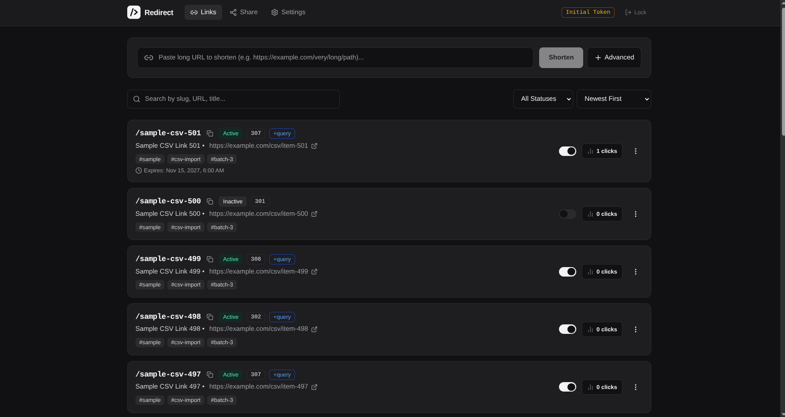
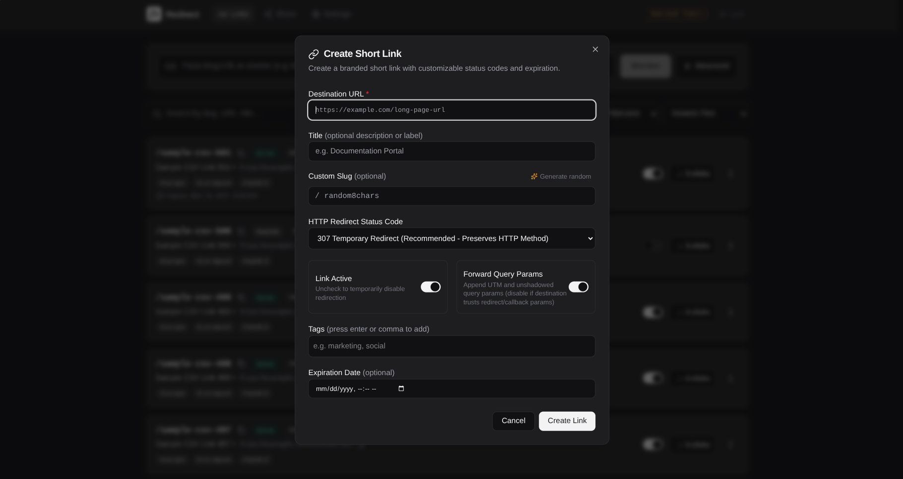
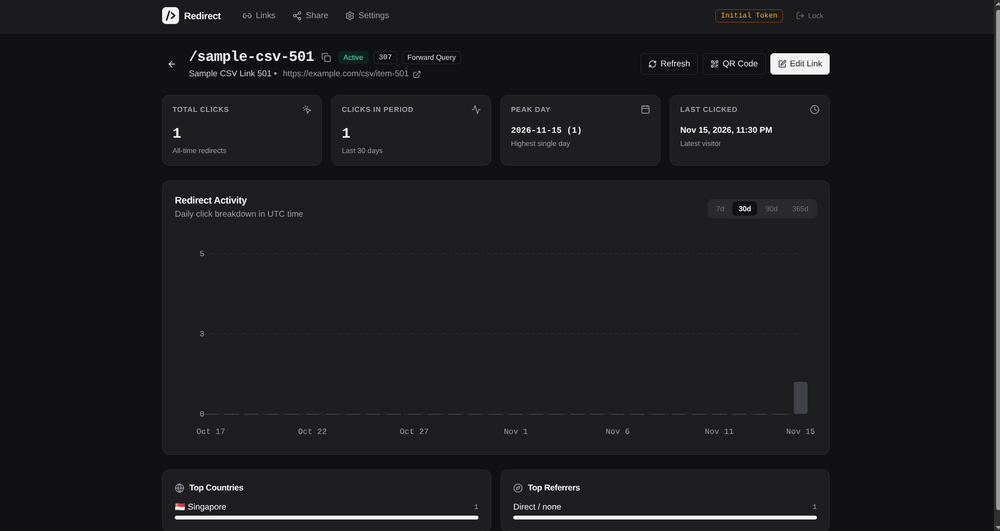
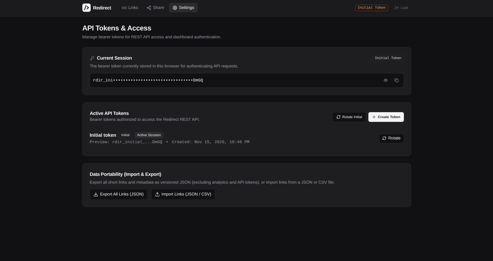

# Redirect

A lightweight URL shortener and link management platform built on Cloudflare Workers with low D1 write overhead (`v0.3.0` — see [CHANGELOG.md](CHANGELOG.md)).

Deployed as a single Cloudflare Worker with Static Assets, Redirect pairs sub-second D1-backed edge redirection with a token-authenticated REST API (`/api/v1/*`) and a React management console (`/app/`).

[Screenshots](#screenshots) · [Deploy](#1-deploy-to-cloudflare) · [Configuration](#2-configuration) · [Architecture](#3-architecture--repository-layout) · [Security](#4-authentication-security--operations) · [Analytics](#5-analytics--d1-cost-budget) · [Backups](#6-backups-export--import) · [Development](#7-local-development--testing)

### Key Features

- **Edge Redirection:** Case-sensitive, mutable slugs, `301`/`302`/`307`/`308` status codes, optional expiration, byte-for-byte query forwarding, and redirect-loop prevention.
- **Management Web Console (`/app/`):** Dashboard for shortening, searching, tagging, filtering, QR code generation, click analytics, JSON/CSV import & JSON export, API token management, and PWA Web Share Target (`/app/share`).
- **Native Android Client:** Companion Android app available at [azraftaohid/redirect-android](https://github.com/azraftaohid/redirect-android).
- **Token-Authenticated API (`/api/v1/*`):** Full link CRUD, analytics queries, token lifecycle controls, cursor-paginated export, and chunk-friendly batch import.
- **Bounded D1 Analytics & Backups:** Daily rollup tables written non-blockingly via `ctx.waitUntil()` (2–4 row writes per click), D1 SQL export and Time Travel recovery, plus portable links-only JSON/CSV transfer.

### Screenshots



| Create Short Link | Link Analytics | Settings & Data Portability |
| :---: | :---: | :---: |
|  |  |  |

---

## 1. Deploy to Cloudflare

`apps/api/wrangler.jsonc` omits account-specific database/KV IDs, `routes`, and variables, and sets `"keep_vars": true`, `workers_dev: false`, and `preview_urls: false`. You can deploy directly from a fork without editing config files, keeping upstream updates easy to sync.

### Option A — Fork & Cloudflare Workers Builds (Recommended)

**Prerequisites:** A Cloudflare account and a GitHub/GitLab fork of this repository (no local Node.js or `pnpm` setup required).

1. **Fork this repository** on GitHub or GitLab.
2. In the [Cloudflare Dashboard](https://dash.cloudflare.com/), connect your fork under **Workers & Pages → Create → Workers Builds** with:
   - **Root directory:** `/`
   - **Build command:** `pnpm run build`
   - **Deploy command:** `pnpm --filter @redirect/api run deploy && pnpm db:migrate:remote`
   - **API token (Advanced settings):** Use a **user-scoped** token with **Edit Cloudflare Workers** and **Account → D1 → Edit** permissions (Cloudflare's default auto-generated Workers Builds token lacks D1 permissions).
3. **Run the first deploy:** Wrangler automatically provisions the `redirect-prod` D1 database and `redirect-auth-tokens` KV namespace, deploys the Worker, and applies D1 migrations.
4. **Customize in the Dashboard (optional):** Open **Workers & Pages → `redirect` → Settings** to add environment variables/secrets (`keep_vars: true` preserves them across deploys) or rebind `AUTH_TOKENS` to an existing KV namespace (future deploys inherit the binding; `DB` resolves `redirect-prod` by name).

Once connected, syncing upstream updates into your fork and merging them automatically triggers a new build, migration check, and deploy.

### Option B — Local CLI Deploy

**Prerequisites:** Node.js 20+, `pnpm` (v12), and a Cloudflare account.

```bash
pnpm install
pnpm --filter @redirect/api exec wrangler login   # add --device in headless/container environments
pnpm run build && pnpm --filter @redirect/api run deploy
pnpm db:migrate:remote
```

> **Note:** Interactive local deploys write the provisioned D1/KV IDs back into `apps/api/wrangler.jsonc`; run `git checkout -- apps/api/wrangler.jsonc` if you don't want IDs committed.

<details>
<summary>Optional: Pre-create D1 and KV before first deploy (for pre-deploy migrations)</summary>

```bash
# Pre-create D1 and apply schema before deploying
pnpm --filter @redirect/api exec wrangler d1 create redirect-prod
pnpm db:migrate:remote

# Pre-create KV namespace (paste ID into wrangler.jsonc, or bind AUTH_TOKENS in Dashboard after deploy)
pnpm --filter @redirect/api exec wrangler kv namespace create AUTH_TOKENS
```

</details>

### Bind a Custom Domain & TLS

1. In the Cloudflare Dashboard, open **Workers & Pages → `redirect` → Settings → Domains & Routes** and add your short domain (e.g., `go.yourdomain.com`).
2. Under **SSL/TLS → Edge Certificates** for your zone, enable **Always Use HTTPS** and **HTTP Strict Transport Security (HSTS)**.

### First Login (Bootstrap Initial Token)

Redirect uses zero-lockout lazy bootstrapping for first-time setup:

1. Open `https://<your-domain>/app/` (or send an unauthenticated request to `GET https://<your-domain>/api/v1/auth/verify`).
2. The `401 Unauthorized` response triggers the Worker to generate `initial_token` (`rdir_initial_<32-char Base62>`) and store it in the `AUTH_TOKENS` KV namespace (`redirect-auth-tokens`), unless `API_KEY` is set or `INITIAL_TOKEN=disabled`.
3. In the [Cloudflare Dashboard](https://dash.cloudflare.com/), go to **Storage & Databases → KV → `redirect-auth-tokens`**, copy `initial_token`, and paste it into `/app/` to unlock the dashboard.

*(In local dev with `pnpm dev`, read it with `pnpm --filter @redirect/api exec wrangler kv key get initial_token --binding AUTH_TOKENS --local`.)*

---

## 2. Configuration

Configure optional variables and secrets in **Workers & Pages → `redirect` → Settings → Variables and Secrets** (`keep_vars: true` preserves them across deploys), in `apps/api/.dev.vars` locally, or under `vars` in `apps/api/wrangler.jsonc`.

| Variable / Secret | Default | Description |
| :--- | :--- | :--- |
| `FALLBACK_URL` | Unset (`404`) | Destination for `307` redirects from `/` and unknown, inactive, or expired slugs. |
| `OWN_HOSTNAMES` | Unset | Comma-separated additional hostnames pointing to this Worker (e.g., `www.go.example.com`) blocked by loop prevention. |
| `ANALYTICS_ENABLED` | `"true"` | Set to `false` (`0`, `off`, `no`) to stop D1 click writes immediately without redeploying. |
| `ANALYTICS_DIMENSIONS` | Unset | Comma-separated optional dimensions (`country`, `referrer`) recorded to `link_daily_dims`. |
| `INITIAL_TOKEN` | Enabled | Set to `"disabled"` (case-insensitive) to disable `initial_token` bootstrapping and auth while keeping custom `token:*` keys active. |
| `API_KEY` *(Secret)* | Unset | Set via `wrangler secret put API_KEY` to enter **strict lockdown mode** (only `API_KEY` is accepted; all KV tokens return `401`). |

For Vite dev server host whitelisting (`ALLOWED_HOSTS` / `VITE_ALLOWED_HOSTS`), see [Local Network & Tailscale Testing](#local-network--tailscale-testing-https).

---

## 3. Architecture & Repository Layout

### Monorepo Structure

| Package / Directory | Role |
| :--- | :--- |
| `apps/api` (`@redirect/api`) | Cloudflare Worker (Hono): request dispatcher (`src/index.ts`), edge redirect handler (`src/routes/redirect.ts`), KV token auth (`src/auth/`), D1 data access & migrations (`src/db/`, `migrations/`), rate limiting, analytics, and audit logging (`src/utils/`). |
| `apps/web` (`@redirect/web`) | React 19 + Vite + Tailwind CSS v4 + Wouter SPA served under `/app/`, including PWA manifest, service worker (`sw.js`), QR modal, analytics charts, and dynamic JSON/CSV importer. |
| `packages/shared` (`@redirect/shared`) | Shared Zod schemas, slug & URL validation, loop prevention, constants, and JSON/CSV import parser. |

### Request Routing

Every request enters the Worker (`run_worker_first: true`) and resolves in strict pathname precedence:

```text
[Incoming Request]
   ├── /api/v1/*          ──► Management REST API (Token auth required; non-v1 /api/* returns JSON 404)
   ├── /app               ──► HTTP 308 redirect to /app/
   ├── /app/*             ──► Frontend SPA (Static assets; SPA fallback to /app/index.html)
   ├── /                  ──► Root handler (HTTP 307 to FALLBACK_URL if valid, else 404 page)
   ├── /:slug             ──► Redirection engine (D1 lookup)
   └── anything else      ──► Exact static asset if present (e.g., /favicon.ico), else 404 page
```

### Redirection Rules

- **Slugs:** Single-segment `^[A-Za-z0-9_-]{1,64}$` (case-sensitive and mutable). Only `api` and `app` are reserved (case-insensitive). Renaming a slug frees the old slug immediately without creating an alias.
- **Status Codes & Caching:** Supports `301`, `302`, `307` (default), and `308`. Permanent redirects (`301`/`308`) emit `Cache-Control: private, max-age=3600` (browser caching prevents repeat clicks from reaching the Worker for analytics); temporary redirects (`302`/`307`) emit `Cache-Control: no-store`.
- **Loop Prevention:** Rejects targets (and `FALLBACK_URL`) whose hostname matches the request host or `OWN_HOSTNAMES` (trailing-dot FQDNs normalized).
- **Query Forwarding:** `forwardQuery` defaults to `true`, merging incoming query params byte-for-byte without overwriting keys already present on the target URL. Disable it per link if the target treats arbitrary query params (e.g., `next` or `redirect_uri`) specially.

---

## 4. Authentication, Security & Operations

### Token Tiers & KV Layout

Tokens are stored in `AUTH_TOKENS` using a self-indexing layout for single-op lookups and instant revocation:

- **`initial_token` (`rdir_initial_<32-char Base62>`):** Admin token generated lazily on bootstrap. Does not expire automatically and grants full access, including `/api/v1/tokens*` management.
- **`token:<id>` (`rdir_<10-char Base62 id>_<32-char Base62 secret>`):** Custom tokens stored with KV metadata (`{ name, createdAt, expiresAt, preview }`). Can manage links and view analytics, and receive `403 Forbidden` on token-management endpoints.

Send tokens in either header:

```bash
curl -H "Authorization: Bearer <token>" https://<your-domain>/api/v1/auth/verify
# or
curl -H "X-API-Key: <token>" https://<your-domain>/api/v1/auth/verify
```

> **Hygiene Tip:** Create expiring custom `token:<id>` keys for daily API/automation use before setting `INITIAL_TOKEN=disabled` (note: disabling `initial_token` freezes `/api/v1/tokens*` management unless `API_KEY` is set).

### Edge Rate Limits & Audit Logs

- **`API_LIMITER`:** `120` requests / `60s` per normalized IP or IPv6 `/64` prefix (`cf-connecting-ip`) across `/api/v1/*`, returning HTTP `429` (`rate_limited`, `Retry-After: 60`).
- **`CLICK_LIMITER`:** `10` requests / `60s` per IP/prefix inside `ctx.waitUntil()` for countable clicks when analytics is enabled—caps D1 write bursts without adding latency to `30x` redirects.
- **Recommended Free Zone WAF Rule:** Add a Cloudflare WAF rate-limiting rule targeting `/api/v1/*` (e.g., 10–30 requests / 10s per IP) for cross-POP protection before Worker execution.
- **Structured Audit Logs:** Mutations (`token.create`, `token.revoke`, `token.revoke_all`, `token.initial_rotate`, `link.create`, `link.update`, `link.delete`, `link.import`, and `auth.forbidden`) emit JSON events via `console.info` without secrets.

### Recovery & Incident Runbook

| Scenario | Action |
| :--- | :--- |
| **Lost all tokens** | Delete `initial_token` in Cloudflare Dashboard KV; the next unauthenticated `/api/v1/auth/verify` or `/app/` load generates a new one (unless `API_KEY` is set or `INITIAL_TOKEN=disabled`). |
| **Compromised custom token** | Revoke it in **Settings → Active API Tokens** (`DELETE /api/v1/tokens/:id`), or clear all custom keys via **Revoke All Custom** (`DELETE /api/v1/tokens` — deletes up to `500` keys per call and returns `{ deleted, count, truncated }`; repeat if `truncated` is `true`). Allow ~60s for KV global propagation. |
| **Compromised `initial_token`** | Rotate via **Settings** or `POST /api/v1/tokens/initial/rotate`, delete `initial_token` in Dashboard KV, set `INITIAL_TOKEN=disabled`, or enable emergency `API_KEY`. |
| **Emergency strict lockdown (`API_KEY`)** | Run `pnpm --filter @redirect/api exec wrangler secret put API_KEY`. Immediately rejects all KV tokens (`401`). Creating custom tokens and rotating `initial_token` return `409 mechanism_disabled`, while `GET /tokens` and `DELETE /tokens*` remain active to audit/purge leftover KV keys. Remove or rotate `API_KEY` to restore/replace. |
| **Analytics flood / D1 quota spike** | Set `ANALYTICS_ENABLED=false` in Dashboard Variables (effective immediately via `keep_vars: true`) and tighten WAF / Under Attack Mode. D1 free-tier quotas reset at `00:00 UTC`. |
| **Malicious short link** | Deactivate or delete in `/app/` or via `DELETE /api/v1/links/:id`, then review Workers Logs for audit events. |

### Optional Cloudflare Zero Trust (Access)

You can layer Cloudflare Access in front of Redirect for SSO protection, though the Worker remains independently token-authenticated (it ignores Access headers/JWTs):

- **Protect:** `/app/*` and `/api/*`
- **Leave public:** `/` and `/:slug`
- Keep `workers_dev: false` and `preview_urls: false` in `wrangler.jsonc` so Access policies cannot be bypassed via `*.workers.dev`.
- For automated CLI access behind Access, include Service Token headers alongside your API token:
  ```bash
  curl -H "CF-Access-Client-Id: <service-token-id>" \
       -H "CF-Access-Client-Secret: <service-token-secret>" \
       -H "Authorization: Bearer <api-token>" \
       https://<your-domain>/api/v1/links
  ```

---

## 5. Analytics & D1 Cost Budget

To keep D1 costs predictable on Cloudflare's row-write billing (Free tier: 100k writes/day; Paid: 50M/month included, then \$1.00/1M), Redirect writes **daily rollup aggregates** rather than a per-click event log, leaves counter columns unindexed, and executes writes inside `ctx.waitUntil()` so D1 failures or limits never affect redirects.

| Metric | Storage Target | Rows Written / Click | Default |
| :--- | :--- | :---: | :---: |
| **Total clicks & last clicked** | Unindexed columns on `links` | 1 | Enabled |
| **Clicks per UTC day** | `link_daily_clicks` (upserted by link ID & date) | 1 | Enabled |
| **Daily clicks by country** | `link_daily_dims` (`dim = 'country'`, `request.cf.country` or `"XX"`) | +1 | Optional |
| **Daily clicks by referrer** | `link_daily_dims` (`dim = 'referrer'`, sanitized host or `"(direct)"`) | +1 | Optional |

| Configuration | Rows / Click | Free-Tier Clicks / Day | Paid Cost / 1M Clicks |
| :--- | :---: | :---: | :---: |
| **Default** (Total + Daily rollup) | **2** | **~50,000** | **\$2.00** |
| **+ Country** (`ANALYTICS_DIMENSIONS="country"`) | **3** | **~33,000** | **\$3.00** |
| **+ Country & Referrer** (`"country,referrer"`) | **4** | **~25,000** | **\$4.00** |

*Bot filtering:* Non-`GET` methods, `Sec-Purpose`/`Purpose` prefetch/prerender headers, empty User-Agents, and common crawler User-Agents are excluded from click counts (though bots spoofing browser User-Agents may still be counted).

---

## 6. Backups, Export & Import

### D1 Database Backups & Time Travel

```bash
# Export full SQLite dump
pnpm --filter @redirect/api exec wrangler d1 export redirect-prod --remote --output=./backup.sql

# Inspect or restore via D1 Time Travel (up to 30 days)
pnpm --filter @redirect/api exec wrangler d1 time-travel info redirect-prod --remote
pnpm --filter @redirect/api exec wrangler d1 time-travel restore redirect-prod --remote --bookmark=<bookmark-id>
```

### Portable Links Export & Dynamic Importer

In **Settings → Data Portability** (or via API), you can export and import links without analytics or tokens:

- **`GET /api/v1/links/export`:** Cursor-paginated `version: 1` JSON (`limit` default `500`, max `1000`; optional `search`, `tag`, `isActive` filters).
- **`POST /api/v1/links/import`:** Imports up to `500` links per request (`onConflict`: `"skip"` default or `"overwrite"`). Overwrite preserves existing `id`, `created_at`, click analytics, and omitted optional fields; past `expiresAt` values are accepted for round-trip fidelity.
- **Web UI Importer (`Settings → Data Portability → Import Links (JSON / CSV)`):** Supports native Redirect `version: 1` exports, arbitrary JSON arrays/nested objects, and RFC 4180 CSV files with interactive field/constant mapping, string/epoch timestamp UTC parsing, pre-flight validation, and automatic `200`-link chunked uploads.

---

## 7. Local Development & Testing

```bash
pnpm db:migrate:local   # Apply D1 schema locally
pnpm dev                # Start Vite (/app/) + Wrangler Worker (127.0.0.1:8787)
pnpm build              # Build @redirect/web and typecheck @redirect/api
pnpm typecheck          # Run TypeScript checks across all packages
pnpm test               # Run Vitest suites (including real Workers runtime via workerd)
```

### Local Network & Tailscale Testing (HTTPS)

Browsers restrict Secure Context features (`navigator.clipboard`, Service Worker registration, PWA/Web Share Target) over plain HTTP on non-`localhost` hosts.

- `apps/web/vite.config.ts` sets `server.host: true` and allows `.local`, `.ts.net`, and comma-separated hosts from `ALLOWED_HOSTS` / `VITE_ALLOWED_HOSTS`. Vite proxies `/api` and `/:slug` to `wrangler dev` on `127.0.0.1:8787`, so only port `5173` needs to be exposed:
  ```bash
  tailscale serve --bg 5173
  ```
  *(Use `tailscale serve status` / `tailscale serve reset` to manage, or `ssh -L 5173:127.0.0.1:5173 <host>` as an SSH tunnel alternative.)*
- `sw.js` only registers in production builds—to test Service Worker / PWA caching locally, run `pnpm build && pnpm --filter @redirect/api exec wrangler dev` and expose port `8787` instead.

### API Endpoints Reference

All `/api/v1/*` routes require `Authorization: Bearer <token>` or `X-API-Key: <token>`.

| Group | Endpoints |
| :--- | :--- |
| **Links & Transfer** | `GET /api/v1/links`, `POST /api/v1/links`, `GET /api/v1/links/export`, `POST /api/v1/links/import`, `GET /api/v1/links/:id`, `PATCH /api/v1/links/:id`, `DELETE /api/v1/links/:id` |
| **Analytics** | `GET /api/v1/links/:id/stats` |
| **Auth & Tokens** | `GET /api/v1/auth/verify`, `GET /api/v1/tokens`, `POST /api/v1/tokens`, `DELETE /api/v1/tokens`, `DELETE /api/v1/tokens/:id`, `POST /api/v1/tokens/initial/rotate` |

---

## 8. Known Limitations

- **Single User / Single Domain:** Designed for personal use and private homelabs; multi-tenant isolation is not implemented.
- **KV Eventual Consistency:** Newly created or revoked tokens propagate globally across Cloudflare KV within ~60 seconds.
- **Bot Heuristic:** Crawlers that spoof standard browser User-Agents without prefetch headers may still register clicks.
